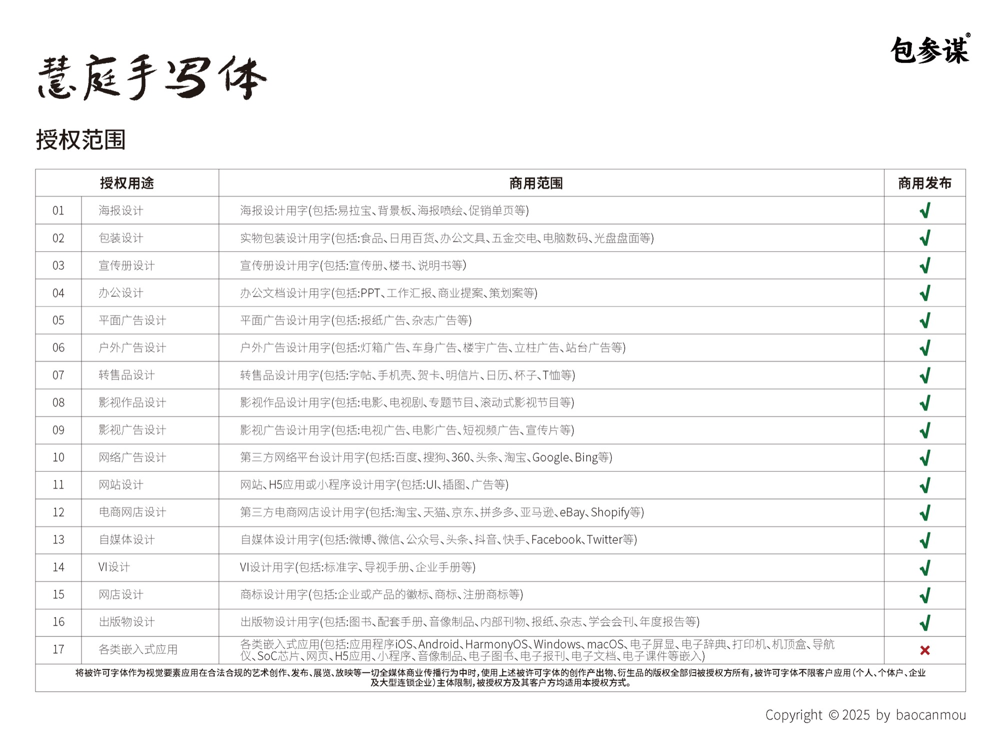

# 包参谋慧庭手写体 · BaoCanMou HuiTing

一款开源的中文手写标题字体，由包参谋品牌设计创始人易慧庭手写、包参谋出品。以 SIL Open Font License 1.1 发布，个人与企业均可免费商用。

An open-source Chinese handwriting display typeface, handwritten by Yi Huiting and published by BaoCanMou. Released under the SIL Open Font License 1.1 — free for personal and commercial use.

## 字体信息

| 项目 | 内容 |
|---|---|
| 版本 | 2.1 |
| 字符 | 9,373 个编码字符，其中汉字 9,170 个，覆盖 GB2312 全部 6,763 个汉字 |
| 字重 | Regular |
| 格式 | TTF（`fonts/ttf`）、WOFF2（`fonts/webfonts`） |
| 适用 | 标题、海报、包装、影视字幕标题、演示文稿；不建议用于大段正文 |

## 下载

在本仓库 [Releases](../../releases) 页面下载最新版本，或直接取用 `fonts/` 目录中的文件。

## 许可

本字体以 [SIL Open Font License 1.1](OFL.txt) 发布。

- 可以：免费商用；嵌入软件、网页、App、视频和印刷品；修改字体；再分发。
- 不可以：单独出售字体文件本身。
- 修改后再分发的字体必须继续使用 OFL 1.1。

「包参谋」为注册商标。许可证授予的是字体软件的使用权，不包含商标授权；修改后的字体请勿以「包参谋」名义发布。

使用本字体无需申请授权。确需书面凭证的单位，可通过 [包参谋官网](https://www.bcmsj.com) 联系出具。

## License (English)

This Font Software is licensed under the [SIL Open Font License, Version 1.1](OFL.txt). You may use, embed, modify and redistribute it freely, including for commercial work. You may not sell the font files by themselves, and modified versions must remain under the OFL.

"包参谋" (BaoCanMou) is a registered trademark. The license does not grant trademark rights; please do not release modified versions under the BaoCanMou name.

## 版权

Copyright 2025 南昌包参谋品牌策划有限公司
作品登记号：赣作登字-2025-F-00114432
设计：易慧庭 · 官网：https://www.bcmsj.com

## 更新记录

- 2.1（2025-12-15）：更新「北」字；更新竖排标点。
- 2.0（2025-09）：字库扩充与修订。
- 1.0（2025-08）：首次发布。
