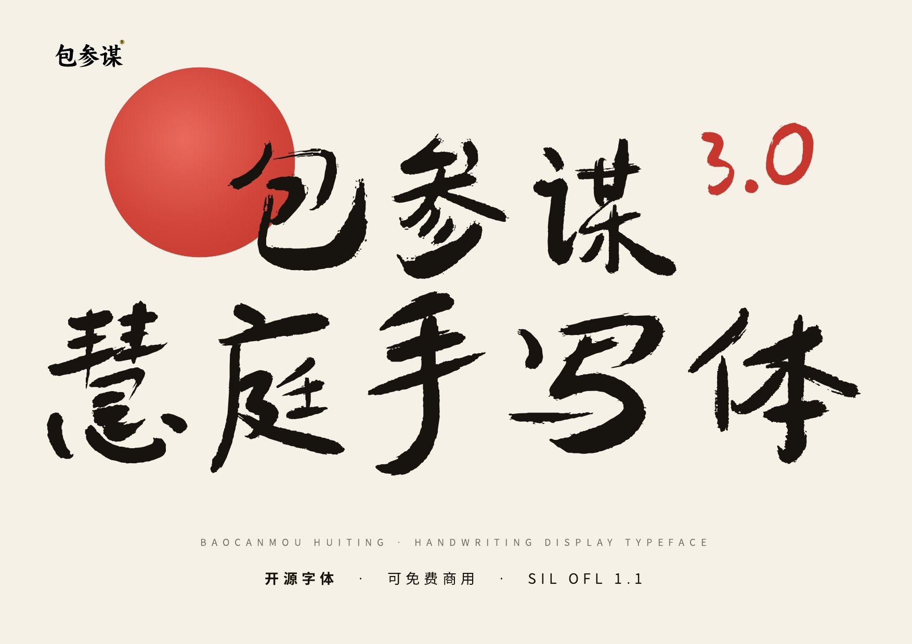
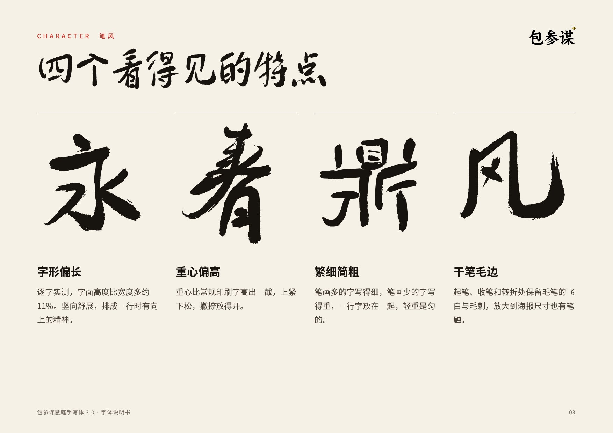
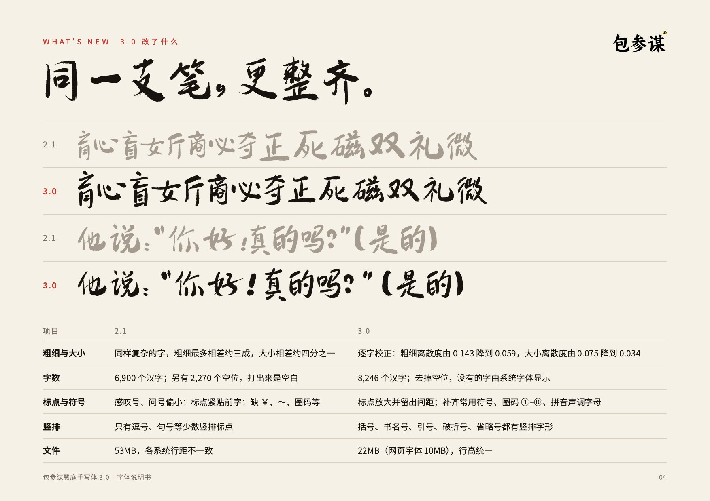
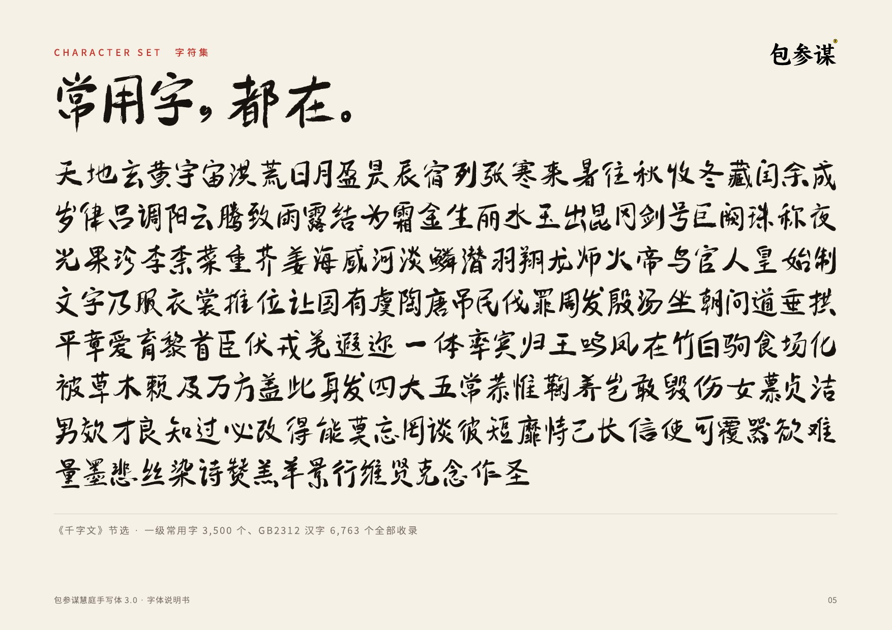
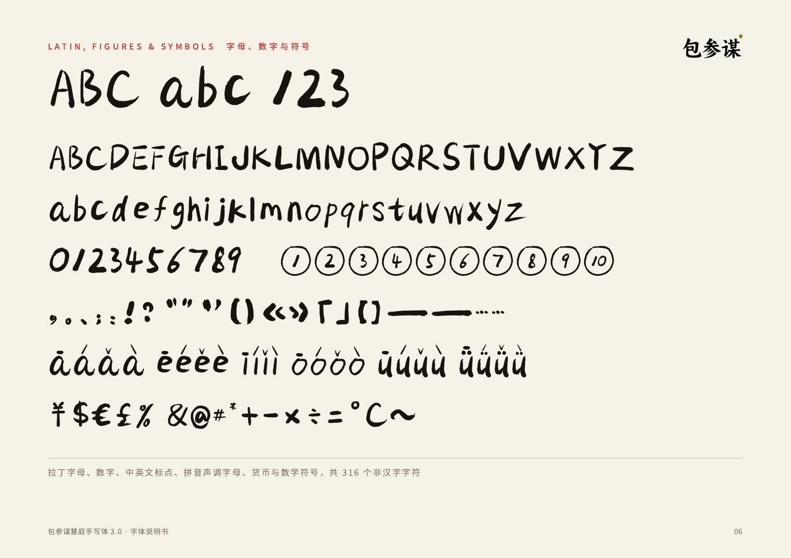
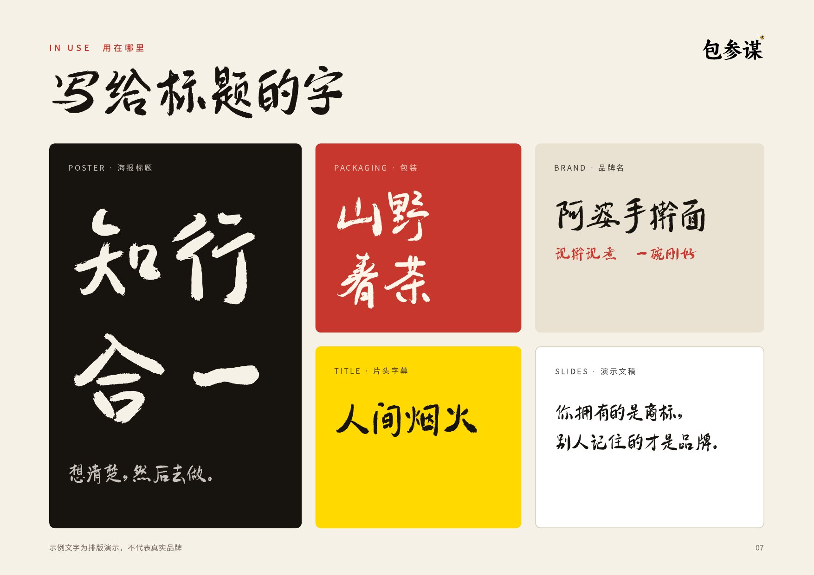
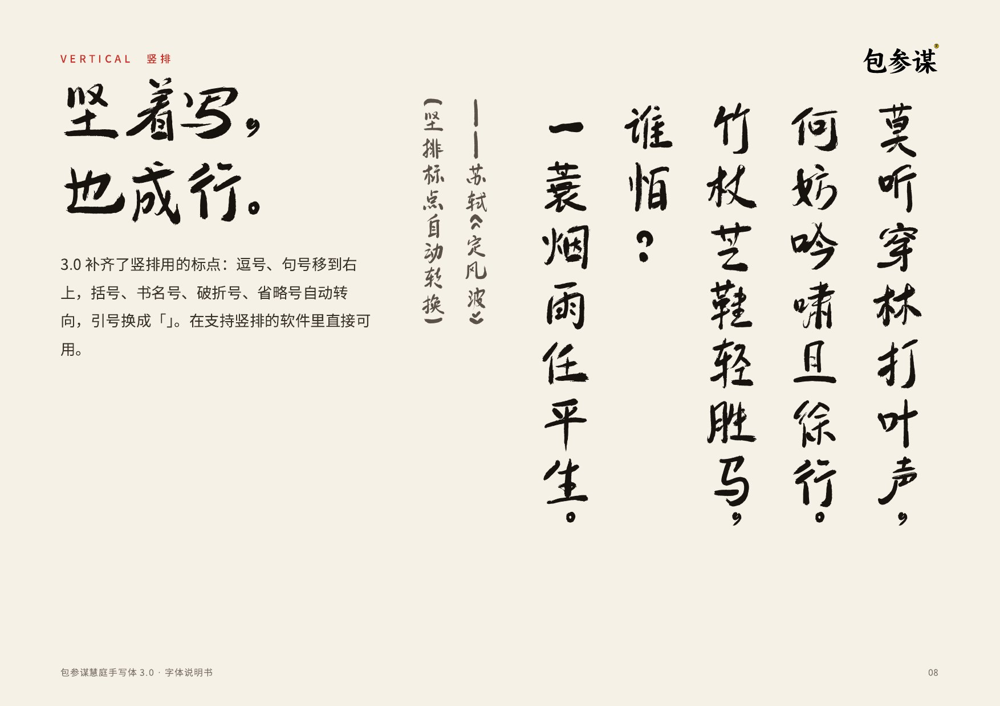

# 包参谋慧庭手写体 · BaoCanMou HuiTing

一款开源的中文手写标题字体，由包参谋品牌设计创始人易慧庭用毛笔书写、包参谋出品。以 SIL Open Font License 1.1 发布，个人与企业均可免费商用。

An open-source Chinese brush-handwriting display typeface, written by Yi Huiting and published by BaoCanMou. Released under the SIL Open Font License 1.1 — free for personal and commercial use.



## 字体信息

| 项目 | 内容 |
|---|---|
| 版本 | 3.0（2026-10） |
| 汉字 | 8,246 个：《通用规范汉字表》8,105 字收录 8,068 字（99.5%），GB2312 的 6,763 个汉字全部收录 |
| 其他字符 | 拉丁字母、数字、中英文标点、拼音声调字母、常用符号，共 316 个 |
| 字重 | Regular |
| 格式 | TTF（`fonts/ttf`，22 MB）、WOFF2（`fonts/webfonts`，10 MB） |
| 竖排 | 支持，含竖排标点 |
| 适用 | 标题、品牌名、包装、海报、片头字幕、演示文稿大字；不建议用于大段正文 |

字的来源：6,900 个汉字为逐字手写；另有 1,346 个生僻字（多为人名、地名用字）由手写的偏旁部件组合而成，清单见 [`documentation/composed-glyphs.txt`](documentation/composed-glyphs.txt)。繁体字、日文假名暂未收录。

## 样张








完整说明书：[`documentation/specimen-3.0.pdf`](documentation/specimen-3.0.pdf)　·　上线海报：[`documentation/poster.jpg`](documentation/poster.jpg)

## 下载与安装

在本仓库 [Releases](../../releases) 页面下载最新版本，或直接取用 `fonts/` 目录中的文件。

- 安装过 1.0、2.x 的，请先移除旧版，避免字体菜单里出现两个同名字体。
- 中文系统里名称为「包参谋慧庭手写体」，英文系统里为 `BaoCanMou HuiTing`。

网页使用：

```css
@font-face {
  font-family: "BaoCanMou HuiTing";
  src: url("BaoCanMouHuiTing-Regular.woff2") format("woff2");
  font-display: swap;
}
```

## 许可

本字体以 [SIL Open Font License 1.1](OFL.txt) 发布。

- 可以：免费商用；嵌入软件、网页、App、视频和印刷品；修改字体；再分发。
- 不可以：单独出售字体文件本身。
- 修改后再分发的字体必须继续使用 OFL 1.1。

「包参谋」为注册商标。许可证授予的是字体软件的使用权，不包含商标授权；修改后的字体请勿以「包参谋」名义发布。

使用本字体无需申请授权。确需书面凭证的单位，可通过 [包参谋官网](https://www.bcmsj.com) 联系出具。

## License (English)

This Font Software is licensed under the [SIL Open Font License, Version 1.1](OFL.txt). You may use, embed, modify and redistribute it freely, including for commercial work. You may not sell the font files by themselves, and modified versions must remain under the OFL.

"包参谋" (BaoCanMou) is a registered trademark. The license does not grant trademark rights; please do not release modified versions under the BaoCanMou name.

## 版权

Copyright 2025 南昌包参谋品牌策划有限公司
作品登记号：赣作登字-2025-F-00114432
设计：易慧庭 · 官网：https://www.bcmsj.com

## 更新记录

- 3.0（2026-10）
  - 字形统一：逐字校正粗细、大小与重心，笔画走向与结构不变。
  - 字库：汉字由实有 6,900 个增至 8,246 个；去掉 2.x 中 2,270 个只有编码没有笔画的空位（此前所写“汉字 9,170 个”包含这些空位，特此更正）。
  - 修正「瑛」「疒」两个错字。
  - 标点与符号：放大感叹号、问号，标点留出间距；新增拼音声调字母、圈码 ①–⑩、〇、℃ 等；全角字母数字为全宽字形。
  - 竖排：新增括号、书名号、引号、破折号、省略号的竖排字形与竖排度量。
  - 文件：清理不可见的碎屑轮廓，TTF 由 53 MB 减至 22 MB；统一各系统行高。
- 2.1（2025-12-15）：更新「北」字；更新竖排标点。
- 2.0（2025-09）：字库扩充与修订。
- 1.0（2025-08）：首次发布。
